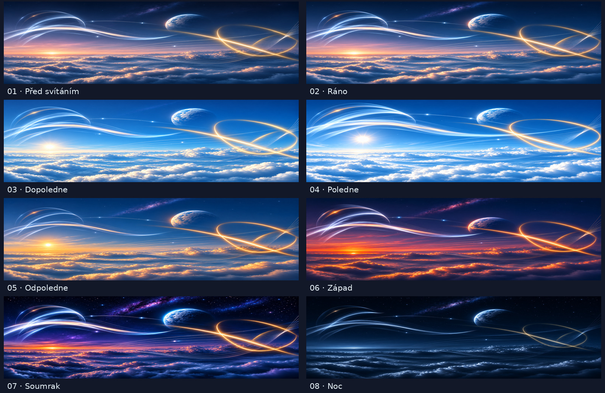

<!-- SPDX-FileCopyrightText: 2026 AllDayLong 2026 project contributors -->
<!-- SPDX-License-Identifier: GPL-3.0-or-later -->

# AllDayLong 2026 – 4K

AllDayLong 2026 is a modern reincarnation of the classic AllDayLong wallpaper. After using the original for more than a decade, I felt it deserved a technological refresh. This edition reimagines it as a dynamic set of eight 4K sci-fi wallpapers, showing one scene gradually changing throughout the day not only for GNOME but KDE or Windows.

## Visual concept

The scene includes:

- An atmospheric landscape above the clouds.
- A planet with changing illumination.
- Modern ionization light streams.
- Golden orbital curves.
- Small light points.
- Daytime and nighttime changes in the sky.

## Dynamic elements

The following elements change between states:

- Planet position.
- Brightness and shape of the light-stream endpoints.
- Position of the light points.
- Intensity of the golden loops.
- Position and illumination of cloud layers.
- Visibility of stars and the cosmic background.

The main scene geometry remains approximately consistent so that transitions do not feel distracting.

## Technical specifications

- 8 PNG images.
- 3840 × 2160 resolution.
- sRGB color space.
- 16:9 aspect ratio.
- One 24-hour daily cycle.
- Smooth transitions in GNOME.
- Time-based switching in KDE and Windows through scripts.

## Quality limitations

The historical reference images are not AI-generated, and their author is unknown. The 2026 reconstruction working assets were created from these references using a generative image model.

The subsequent reconstruction was completed at 3840 × 2160.

New light details were rendered at the target resolution.

**This is not a fully native 4K render of the entire scene, nor does it use neural super-resolution.**

## Installation

### Dependencies

- **GNOME:** GNOME desktop, Bash, Python 3, and `gsettings`. Python is used only during installation to validate the slideshow and generate a runtime XML file with absolute image paths; GNOME does not need Python to display the installed slideshow.
- **KDE Plasma 6:** Plasma 6, Bash, Python 3, a systemd user session, `kwriteconfig6`, and either `qdbus6` (or a compatible `qdbus` command) or `gdbus`.
- **Windows 10/11:** 64-bit Windows PowerShell 5.1 and Task Scheduler, both included with supported Windows versions.

No additional wallpaper application or plugin is required.

### GNOME

Native XML slideshow.

Run `install-gnome.sh`.

### KDE Plasma 6

Run `install-kde.sh`.

Features:

- Time-based switching.
- Desktop and lock-screen synchronization.
- A systemd user timer.
- The KDE Plasma Scripting API.

### Windows 10/11

Run `powershell.exe -NoProfile -ExecutionPolicy Bypass -File .\install-windows.ps1`.

Features:

- XML-based switching.
- Desktop and lock-screen synchronization where supported.
- Task Scheduler integration.
- Refresh on login.

## Documentation

- `INSTALLATION.md` – main installation overview.
- `docs/INSTALLATION-GNOME.md` – GNOME.
- `docs/INSTALLATION-KDE.md` – KDE Plasma 6.
- `docs/INSTALLATION-WINDOWS.md` – Windows 10/11.
- `docs/IMAGE-QUALITY.md` – properties and limitations of the current 4K reconstruction.
- `docs/PROMPT-INSTRUCTIONS.md` – instructions for future regeneration and improvements.
- `docs/SOURCES.md` – historical links and technical references.
- `docs/original-AllDayLong/` – historical reference images and the original XML.
- `LICENSE.md` – licensing matrix for software, documentation, artwork, and historical references.

The installers use the images and configuration directly from the extracted directory. Keep it in a private user-owned location that other users cannot modify. Do not move or delete it after installation; if you move it, rerun the appropriate installer.

## Origin, authorship, and license

AllDayLong 2026 is a modern reinterpretation of the classic **All Day Long** dynamic wallpaper shared with the GNOME/Linux community in 2008. The original wallpaper contained eight scenes representing different times of day, with transitions controlled by a timed GNOME XML configuration.

**Original author:** unknown — authorship has not been independently verified.

The historical JPG files are not AI-generated. The working source illustrations for the 2026 reconstruction were created with OpenAI `image_gen`; the final 4K version was then reconstructed using Python and Pillow. See `docs/IMAGE-QUALITY.md` for details.

Historical articles, the unavailable original listing, and technical references are collected in `docs/SOURCES.md`.

This project acknowledges the original artwork and concept. If you are the original author or have reliable information about its authorship or license, please provide supporting information so that the correct attribution can be added.

### Licensing

The installation scripts, current XML configuration, build utilities, and project-authored documentation are licensed under **GPL-3.0-or-later**. Distributed modifications must remain under the GPL and include the corresponding source.

The new output files `images/01.png` through `images/08.png` and the preview `preview.jpg` are provided under the [Creative Commons Attribution-ShareAlike 4.0 International license (CC BY-SA 4.0)](https://creativecommons.org/licenses/by-sa/4.0/). When redistributing them, credit **AllDayLong 2026 – 4K**, link to this project, and state that it is an AI-generated and subsequently post-processed reconstruction. Adapted versions must use the same license.

The historical JPG files in `docs/original-AllDayLong/` are **not covered** by CC BY-SA 4.0. Their author and original license are unknown. They are included as source references and provenance records, not as works newly licensed by this project.

If you are the original author or represent the rights holder and object to the publication or processing of the historical images, contact the repository maintainer. Their origin and license status will be reviewed promptly, and the affected files or links will be changed or removed as appropriate.

The exact scope of every license, full license texts, and recommended attribution are provided in `LICENSE.md` and `LICENSES/`.

## Limitations

- GNOME XML is not natively supported by KDE or Windows.
- KDE and Windows do not use smooth transitions.
- Lock-screen synchronization is not guaranteed in every configuration.
- The SDDM login screen is not part of KDE synchronization.
- Windows lock-screen automation may be restricted by system policies.
